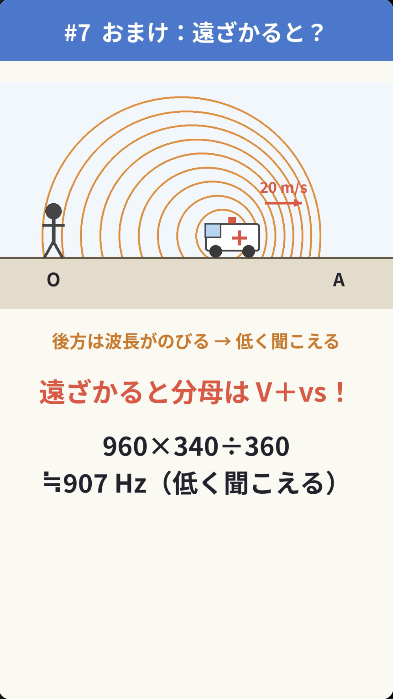

# StudyStudio

**Snap a problem, get a 30-second explainer made just for you.**
StudyStudio is a team of 5 Grok Bots that turns a student's problem photo into a personalized 30-second vertical explainer video plus a check question — and remembers each student's weak spots so the next lesson gets better. Built for the Grok Bot hackathon.

[日本語 README](README.ja.md)

## Demo / デモ動画

- [assets/demo-doppler.mp4](assets/demo-doppler.mp4) — high-school physics, Doppler effect (ambulance siren). The [Demo](#demo) section below has the reviewer score and the check question.
- [assets/demo-2.mp4](assets/demo-2.mp4) — high-school physics, a helium balloon in a bus turning left (inertial force and apparent gravity).

## Concept
When students study on their own, nobody is there to notice *where* they get stuck. StudyStudio plays the role of a cram-school team: a homeroom tutor who knows the student, a lecturer who solves, a scriptwriter, a strict reviewer, and a short-video director.

## How it works
1. The student sends a problem photo to the **Tutor** in Grok Bot chat.
2. The Tutor reads the student's Notion page and writes a request ticket (problem, unit, weaknesses to target).
3. The **Solver** solves it the textbook way, double-checks, and drafts check questions.
4. The **Scriptwriter** turns it into a 30 s script/storyboard, spending more time on the student's weak step.
5. The **Reviewer** scores it (correctness 50 + clarity 50). ≥80 passes; calculation errors go back to the Solver, <80 back to the Scriptwriter; after 3 failed rounds the bot admin is consulted.
6. The **Short Director** renders a 1080×1920, 30 s, captions-only video.
7. The Tutor saves the video, records the question in the student's Notion page (question history, mistake types, weak units, last-solved date), delivers the video, then posts the check questions and grades the reply in chat. Scores / accuracy rates are not stored.

See [docs/architecture.md](docs/architecture.md).

## The 5 roles (mapped to real professions)
| Bot | Real-world role | Prompt |
|---|---|---|
| 担任bot先生 Tutor | cram-school tutor / learning coach — never solves, tracks weaknesses & question history | [bots/tutor.md](bots/tutor.md) |
| 受験問題解答bot Solver | lecturer — solution, approach, check questions | [bots/solver.md](bots/solver.md) |
| 構成作家bot Scriptwriter | 構成作家 (TV scriptwriter) — 30 s script & storyboard | [bots/scriptwriter.md](bots/scriptwriter.md) |
| 受験問題解説レビューbot Reviewer | director / QA — correctness 50 + clarity 50, ≥80 pass, 3 fails → bot admin | [bots/reviewer.md](bots/reviewer.md) |
| ショート監督bot Short Director | short-video director & editor — 1080×1920, 30 s, captions only | [bots/short-director.md](bots/short-director.md) |

## The feedback loop
Weakness found by the Tutor → reflected in the video and check question → question history written back to Notion → next request targets the student's recurring weak units.

## Design guide
Station-wayfinding style: white background, bold gothic, fixed step colors (①red ②blue ③green ④orange ⑤purple), "▶ いまここ" highlight, safe area. See [docs/design-guide.md](docs/design-guide.md).

## Demo
[assets/demo-doppler.mp4](assets/demo-doppler.mp4) — high-school physics, Doppler effect (ambulance siren). Reviewer score 93/100; check question (changed speed) answered correctly in chat; question logged to Notion.

## Setup
1. Create 5 Grok Bots and paste each prompt from `bots/` as its description.
2. Replace placeholders in the prompts with the real bot IDs: `<TUTOR_BOT_ID>`, `<SOLVER_BOT_ID>`, `<SCRIPTWRITER_BOT_ID>`, `<REVIEWER_BOT_ID>`, `<SHORT_DIRECTOR_BOT_ID>`.
3. Connect Notion; create a parent page 「学習支援チーム 生徒カルテ」 and one page per student using [docs/notion-student-template.md](docs/notion-student-template.md). Replace `<NOTION_PARENT_PAGE_ID>` and `<NOTION_STUDENT_PAGE_ID_n>`.
4. (Optional) Connect Google Drive, create an archive folder and replace `<DRIVE_FOLDER_ID>`.
5. Send a problem photo to the Tutor.

## Roadmap
- More entry points (iMessage / LINE for families, schools, cram schools)
- More subjects and grades by adding student pages
- Optional narration track
- Teacher dashboard over Notion data
- Publishing pipeline for SNS-ready content

## License
MIT
