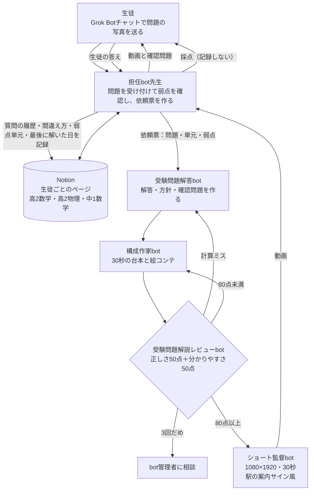

# Architecture

Hand-offs between bots use Grok Bot agent-to-agent messages (SendToAgent). Student data lives in Notion (one page per student). Videos are rendered on the bot box with Manim + ffmpeg.
